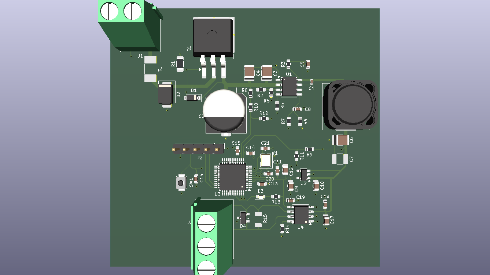
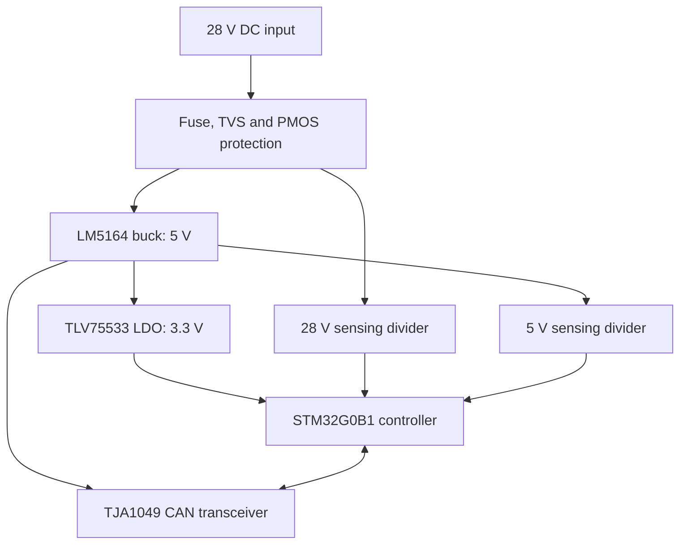

# 28 V Power Control Interface

Four-layer PCB design for a nominal 28 V DC input, with input protection, a 5 V buck converter, a 3.3 V logic supply, STM32 voltage-sensing inputs, and a CAN physical interface.



> **Project status:** Schematic capture and PCB layout are complete. The design report records zero KiCad ERC/DRC errors. **No PCB has been fabricated, no firmware is included, and no electrical or EMC measurements have been performed.** All calculated operating values below are design estimates, not test results.

## Overview

This personal hardware-design project explores the process of developing a compact monitoring and communication board for a nominal 28 V DC supply. The work covers component selection, hand calculations, schematic capture, four-layer PCB layout, basic design-rule verification, and technical documentation.

The board is *not* an experimentally validated power supply or a product qualified for automotive, aviation, or industrial transient/EMC standards.

## Key specifications

| Item | Design value / implementation |
| --- | --- |
| Nominal input | 28 V DC |
| Input protection | 1 A fuse, SMBJ36CA bidirectional TVS, P-channel MOSFET reverse-polarity stage, gate Zener |
| Main converter | Texas Instruments LM5164 synchronous buck |
| Buck output | Approximately 5 V; **1 A design target** (not measured) |
| Approximate switching frequency | 303 kHz, calculated from the selected RON resistor |
| Power inductor | 47 µH, Coilcraft MSS1260T-473MLD |
| Logic supply | 3.3 V, TLV75533 LDO |
| Microcontroller | STM32G0B1CBT6, 16 MHz external crystal |
| Voltage-sensing inputs | Resistor-divider/RC-filter networks for nominal 5 V and 28 V rails, connected to STM32 ADC pins |
| CAN interface | NXP TJA1049 transceiver, CAN-line ESD protection, optional 120 Ω termination (DNP) |
| Programming interface | 5-pin SWD header and reset pushbutton |
| PCB size | 70.25 × 67.75 mm |
| PCB stack-up | F.Cu / In1.Cu (GND) / In2.Cu (GND) / B.Cu; nominal 1.6 mm board thickness |
| EDA tool | KiCad 10.0 |

## System architecture



The STM32 hardware provides ADC connections for rail monitoring and digital connections to the CAN transceiver. Firmware for sampling, calibration, reporting, and CAN communication remains future work.

## Design highlights

### 1. Input protection

- A 1 A fuse is provided for sustained overcurrent protection.
- An SMBJ36CA TVS is used for transient suppression; its standoff and clamping characteristics must be assessed against a defined source and transient profile.
- A P-channel MOSFET provides reverse-polarity protection. A 12 V Zener network limits the magnitude of its gate-to-source voltage.
- Protection coordination and survival under specified surge waveforms have **not** been verified by test.

### 2. Buck converter and component sizing

- The LM5164 stage converts a nominal 28 V input into an approximately 5 V rail.
- The selected 316 kΩ / 100 kΩ feedback divider gives a nominal calculated output of approximately **4.992 V**.
- The chosen 47 µH inductor and approximately 303 kHz switching frequency yield a calculated inductor-current ripple of **0.288 A** at the nominal design point.
- A 22 µF output capacitor is populated; the second 22 µF position (C7) is marked **DNP**.
- PCB placement emphasizes the switching-current loop, a restrained SW-node area, and feedback routing away from noisy nodes.

### 3. Monitoring, programming, and CAN

- The 5 V measurement divider scales a nominal 5 V input to approximately **2.500 V** at the ADC input.
- The 28 V measurement divider scales a nominal 28 V input to approximately **0.824 V**.
- Both measurement paths include RC filtering. Appropriate ADC sampling time and calibration would need to be addressed in firmware.
- The CAN physical interface uses a TJA1049 transceiver and an ESD suppressor. A 120 Ω termination position (R15) is provided but not populated by default; termination depends on the node's position in the CAN network.

### 4. Four-layer PCB

The two internal copper layers are assigned to GND fills to support return-current paths for top- and bottom-layer routing. Component placement considers the buck power loop, local MCU decoupling, crystal proximity, and CAN protection near the external connector.

See the [four-page PCB layer exports](docs/PCB_Layer_Exports.pdf), a [color top-layer view](docs/PCB_Top_Layer_View.pdf), and the [complete schematic](docs/Complete_Schematic.pdf).

## Verification and limitations

| Activity | Status |
| --- | --- |
| Component selection and hand calculations | Documented |
| Schematic capture and PCB layout | Complete |
| KiCad ERC / DRC | **0 errors recorded in the design report**; not independently rerun for this publication |
| Physical PCB fabrication and assembly | Not performed |
| Power-up, oscilloscope, thermal, and CAN tests | Not performed |
| Embedded firmware and closed-loop control | Not included |
| Defined transient/EMC standard compliance | Not designed or verified |

The layout's passing design-rule checks do not establish electrical performance, manufacturability, or standards compliance. In particular, transient protection, thermal behavior, regulator stability, and sensing accuracy require further review and practical validation.

## Repository contents

```text
28V-Power-Control-Interface/
├── README.md
├── hardware/
│   ├── 28V_Power_Control_Interface.kicad_pro
│   ├── 28V_Power_Control_Interface.kicad_sch
│   ├── MCU_CAN.kicad_sch
│   └── 28V_Power_Control_Interface.kicad_pcb
├── docs/
│   ├── Technical_Design_Report_TR.pdf
│   ├── Complete_Schematic.pdf
│   ├── PCB_Layer_Exports.pdf
│   ├── PCB_Top_Layer_View.pdf
│   └── BOM.xlsx
└── images/
    └── PCB_3D.png
```

### Open the design

1. Install a compatible version of **KiCad 10**.
2. Open `hardware/28V_Power_Control_Interface.kicad_pro`.
3. Keep the top-level schematic and `MCU_CAN.kicad_sch` in the same directory so the hierarchical sheet resolves correctly.

### Documentation

- [Technical design report (Turkish, 18 pages)](docs/Technical_Design_Report_TR.pdf) — design rationale, calculations, electrical assumptions, PCB decisions, and limitations.
- [Complete schematic (PDF)](docs/Complete_Schematic.pdf)
- [PCB layer exports (four-page PDF)](docs/PCB_Layer_Exports.pdf)
- [Color top-layer view (PDF)](docs/PCB_Top_Layer_View.pdf)
- [Bill of materials (Excel)](docs/BOM.xlsx) — includes part numbers and DNP information.

## Author

**Görkem Orakbiçen**  
Electrical and Electronics Engineering, Dokuz Eylül University

This is an independently developed portfolio design. It does not represent a validated or production-released hardware product.
